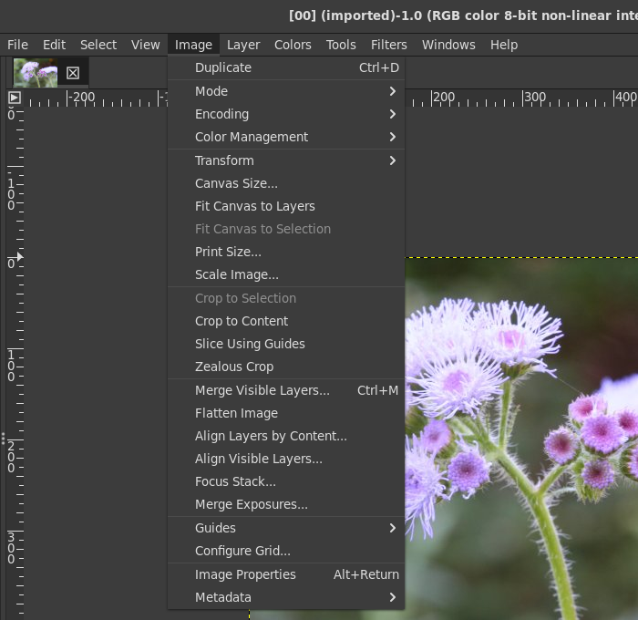
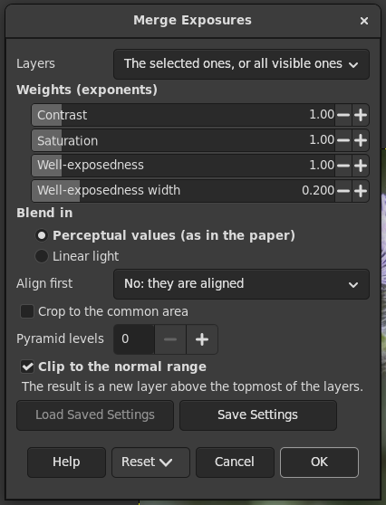
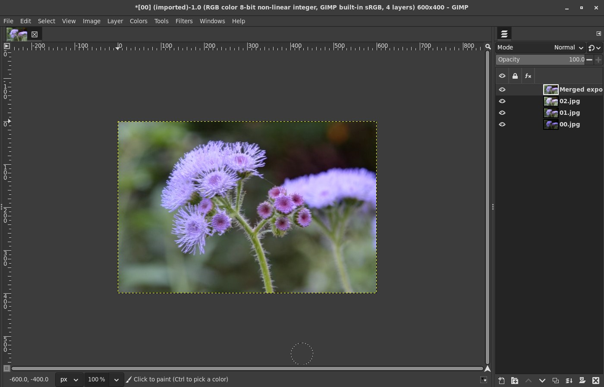
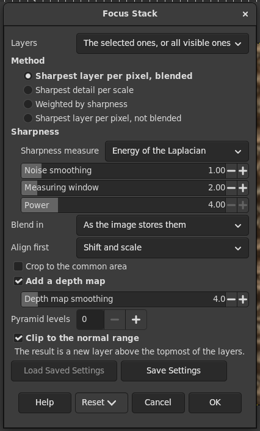
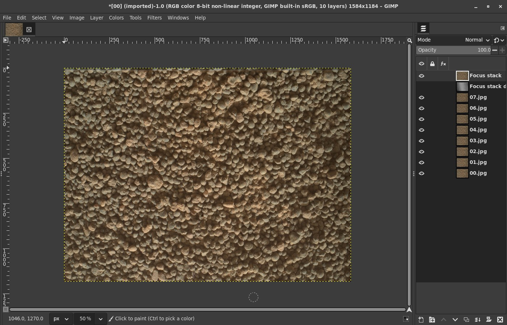
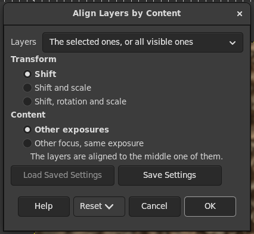
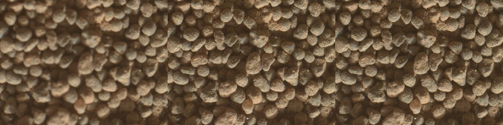
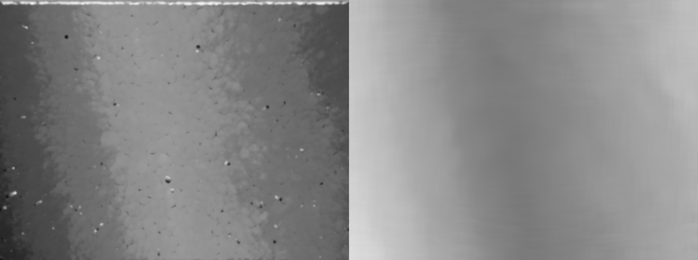
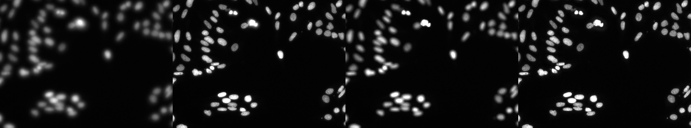

# gimp-fusion

Exposure fusion and focus stacking for GIMP 3, in C, for photographs and
for microscopy: 8 and 16 bits and floating point, RGB and gray, any number
of layers.

- **Image > Merge Exposures...** blends a bracket of exposures into one
  well exposed layer (Mertens, Kautz and Van Reeth 2007). No HDR image
  and no camera curve are needed.
- **Image > Focus Stack...** merges layers focused at different depths
  into one sharp layer, with a depth map if you want one.
- **Image > Align Layers by Content...** lines the layers up (shift,
  scale, rotation) by what they show. Both merges can also align first.

The three sit in the Image menu next to Merge Visible Layers and Align
Visible Layers:

The result is always a new layer above the topmost of the layers used;
the layers themselves stay as they are.

## Why

GIMP 3.2 has no bracket merge and no focus stacking (researched in
[gimp-devtools/docs/candidates.md](../gimp-devtools/docs/candidates.md),
item 6, and
[prior-art-candidates.md](../gimp-devtools/docs/prior-art-candidates.md)).
The old Exposure Blend script is GIMP 2 only. G'MIC has only experimental
exposure fusion filters in its Testing section. The one GIMP 3 focus
stacking plug-in found, dcknuth/gimp_focus_stack, is a Windows-only wrapper
around `focus-stack.exe` with 8-bit JPEG output. Wrappers around enfuse or
Hugin's `align_image_stack` are no answer either: the Flatpak GIMP cannot
start programs on the host (not without a `flatpak override` by the
user). So everything here is done in the plug-in
itself.

## Using it

### Merge Exposures

- **Layers**: the selected layers if two or more are selected, otherwise
  all visible layers; or explicitly the selected, the visible or all
  (top level) layers. Order does not matter for exposure fusion.
- **Weights**: the exponents of the paper's three quality measures:
  contrast (the magnitude of the Laplacian of the gray image), saturation
  (the spread of R, G and B) and well-exposedness (a Gaussian around 0.5
  per channel, of the given width; the paper uses 0.2). 0 switches a
  measure off; all at 1 is the paper's default.
- **Blend in**: perceptual (gamma encoded) values, as the paper does (its
  examples are camera JPEGs "with unknown gamma correction and camera
  response curve"), or linear light.
- **Align first**, **Crop to the common area**: see [Alignment](#alignment).
- **Pyramid levels**: 0 uses as many as the paper's code,
  floor(log2(shorter side)). More levels blend over larger distances
  (fewer low frequency halos, a little more overshoot).
- **Clip to the normal range**: the blend can overshoot slightly at
  strong edges; in a floating point image you can keep those values.

### Focus Stack

- **Method**:
  - *Sharpest layer per pixel, blended* (default): each pixel's sharpest
    layer gets weight 1, the others 0, and these masks are blended in a
    Laplacian pyramid, so the seams do not show (the "hard mask" that
    enfuse uses for focus stacks).
  - *Sharpest detail per scale*: at every level of the pyramid, the
    coefficient with the most local energy (Burt and Kolczynski 1993);
    the coarsest level is averaged. Slightly crisper, slightly more
    prone to noise.
  - *Weighted by sharpness*: weights sharpness^power, blended: smoother
    and less noisy, a little softer.
  - *Sharpest layer per pixel, not blended*: the layers' own pixel values,
    unchanged, for measurements (tested bit for bit).
- **Sharpness**: the local energy of the Laplacian (default) or the local
  variance; a blur before measuring so that noise does not count as
  detail; the size of the measuring window.
- **Blend in**: as the image stores its pixels (default: a linear 16-bit
  microscope image is blended in linear light), perceptual or linear.
- **Add a depth map**: a second, hidden layer under the result: black
  where the bottom layer was sharpest, white for the top one, fractions
  in between from a parabola through the neighbouring layers' sharpness.
  It is smoothed (sigma 4 by default) with the sharpness as the
  confidence, so that flat areas take their depth from textured
  neighbours. The numbers stored are proportional to the depth, in the
  image's own encoding.

### Align Layers by Content

Moves the layers so that they line up with the middle one of them:
shift, shift and scale, or shift, rotation and scale. "Other exposures"
compares local contrast (brightness and contrast may differ between the
layers), "Other focus" compares the brightness itself. The layers are
transformed by GIMP (with its interpolation) and keep their size and
place. One undo step.

### From scripts

The procedures are `plug-in-fusion-merge-exposures`,
`plug-in-fusion-focus-stack` and `plug-in-fusion-align-layers`; the
argument names are those of the dialogs (`contrast`, `saturation`,
`exposure`, `exposure-width`, `space`, `method`, `measure`, `noise`,
`window`, `power`, `depth-map`, `depth-smooth`, `align`, `crop`,
`levels`, `clip`, `layers`). Merge Exposures returns the new layer, Focus
Stack also the depth layer.

## How it is built, and why this way

A C plug-in on a core library of its own (`src/core`, plain C11 with
OpenMP, no GIMP and no GEGL), which a command line tool (`fusion-cli`)
and the unit tests use too.

The other way would have been GEGL operations for the stages, chained by
the plug-in. It was not taken because:

- **Memory.** A pyramid blend needs whole images, not tiles. A GEGL
  operation with N inputs would have all N inputs as whole float
  buffers at once. The plug-in instead reads one layer at a time and
  streams the stack through the core twice (weights, then blend), so the
  memory is that of a few images whatever the number of layers: 30 slices
  of 4 MP take 254 MB in GIMP, 5 exposures of 24 MP 1.4 GB (see
  [Speed and memory](#speed-and-memory)).
- **N inputs.** GEGL pads are fixed per operation class, and GIMP's
  filter dialog offers `aux`, `aux2` ... pickers, not "these 30 layers".
- **No gain in editability.** GIMP 3.2 applies any filter with an aux
  input destructively anyway (verified in `app/tools/gimpfiltertool.c`
  at `GIMP_3_2_6`, see the research notes above).

### Methods

**Exposure fusion** follows the paper and Mertens' own Matlab code
(BSD-2-Clause, github.com/Mericam/exposure-fusion): the Burt-Adelson
kernel [1 4 6 4 1]/16, its edge handling, its number of levels, Matlab's
rgb2gray for the gray image, and its 1e-12 added to every weight. Two
things differ, on purpose:

1. Contrast below 1e-6 of the pixel value counts as none. The core works
   in single precision (Matlab in double); on ramps of equal 8-bit steps
   the Laplacian is exactly 0 in double but leaves rounding crumbs of
   about 1e-7 in float, which outweigh the 1e-12 and decided areas that
   no image shows any contrast in (differences up to 0.04 before this
   rule, 3e-5 after it).
2. Where no layer covers the canvas (layers smaller than the canvas, or
   the borders after alignment) the weights there sum to 0, and the
   paper's blend would darken the coarse levels far around such areas.
   The core divides every level by the Gaussian pyramid of the summed
   weights, which is exactly 1 where all layers are present (so the
   paper's result is unchanged there).

**Focus stacking**: the sharpness of each layer is the local energy of the
Laplacian of its luma (Rec. 709), after a slight blur against noise. The
depth map's fraction comes from a parabola through the sharpness of the
best layer and its neighbours, tracked on the fly, so that no stack of
sharpness maps is kept.

**Alignment** compares each layer with its neighbour towards the middle
one and chains the transforms, so that only similar layers (one stop, one
focus step apart) are ever compared. For a pair: Gaussian pyramids;
phase correlation (with the sinc peak estimator of Foroosh, Zerubia and
Berthod 2002) on a level of at most 512 pixels for the shift, then
Gauss-Newton (Lucas-Kanade with ESM gradients and a gain and offset)
from about 64 pixels up to full resolution for shift, scale and rotation.
For exposures it compares locally normalized images, and leaves out
clipped pixels; for focus stacks the plain ones. Layers are warped with
Catmull-Rom interpolation (or, in Align Layers by Content, by GIMP).

## Tests

    tests/run.sh

runs everything below; each part also runs alone. Everything builds and
runs inside the GIMP Flatpak and its SDK
([gimp-devtools](../gimp-devtools)), isolated from your folders: a
listing of your GIMP, Blender, Godot, Krita and Tiled folders before and
after must be the same. Nothing is installed.

| Part | What | Result |
|---|---|---|
| `tests/check.sh` | unit tests of the core (pyramids against a literal port of Mertens' upsample.m, FFT against the DFT, fusion, focus methods, alignment, tiny images, NaN, missing pixels), as usual and under ASan and UBSan with leak checks | 64 of 64, no sanitizer reports |
| `tests/crosscheck.sh` | the core against a numpy port of Mertens' Matlab code, OpenCV's MergeMertens and synthetic scenes with known answers | 25 of 25 |
| `tests/gimp-test.sh` | the plug-in in GIMP without a window: 8, 16 bits and float, RGB and gray, selections out of order, groups, masks, offsets, alignment, cropping, errors, the menus; compared with fusion-cli on the layers as GIMP reads them; `--asan` with the plug-in under the sanitizers | 22 + 21 checks, also under ASan |
| `tests/real.sh` | real, freely licensed images (below) | 13 of 13 |
| `tests/gui/gui-test.sh` | the real dialogs on Broadway: menu, dialogs, OK, results, screenshots | 14 of 14 |
| `tests/bench.sh` | time and memory of big stacks | numbers below |

Measured (all in `tests/output/crosscheck.json` and `real.json`):

- **Exposure fusion against Mertens' code** (numpy port, float64): largest
  difference 3.3e-5 for 5 frames of 8 bits (138 dB), 2e-6 to 2e-5 with
  other weights, levels, gray and odd sizes; 8.8e-5 on the real CC0
  bracket. For 16 bits the largest difference is 1.8e-4 against the port
  with the rule for contrast below 1e-6; against the literal port 0.014 on
  18 % of the pixels, because in smooth 16-bit areas every frame's
  contrast is at float resolution (see Methods, and Limits).
- **Against OpenCV 5.0's MergeMertens** (independent, Apache-2.0, from a
  SHA-256 pinned wheel in `tests/output/venv`): OpenCV's result matches
  ours with one pyramid level more than Mertens' code uses (27.3 dB with
  the paper's number of levels; judged from these measurements, not from
  OpenCV's source); with that many levels 36.4 dB on the synthetic scene and 41.6 dB on the real
  bracket, inside a 16 px border. The rest is edge handling and its gray
  conversion.
- **Focus stack, synthetic** (8 RGB slices blurred by a known depth map):
  53.7 dB against the sharp image (best single slice 34.3 dB); per
  method: coefficients 55.0, pixels 50.8, soft 49.0 dB; noisy 8-bit
  slices 38.7 to 41.1 dB (best slice 33.3 dB). Depth map: correlation
  0.998 with the true depth, mean error 0.077 slices.
- **Microscopy, synthetic** (12 noisy 16-bit gray slices, magnification
  +0.2 % per slice, drift): aligned 36.8 dB, unaligned 27.0 dB, best slice
  26.3 dB; depth correlation 0.997 on the cells.
- **Alignment, synthetic**: a bracket of 5 (EV -4 to +4) moved by up to
  4.7 px and 0.34 degrees: found to 0.02 to 0.04 px at the corners;
  fused after alignment 46.1 dB against the frames put back with the true
  transforms (22.1 dB without alignment). A drifting focus stack of 8:
  within 0.11 px. Pairs in the unit tests: 0.001 to 0.005 px, rotation
  1.5 degrees and scale 0.98 included; 0.02 px against another exposure.
- **Real images**:
  - *Curiosity MAHLI focus stacks* (8 slices each; the rover also sent
    back its own onboard merge and range map): our stack is as sharp as
    the onboard merge (101 % and 98 % of its Laplacian energy; the
    sharpest single slice has 96 % and 60 %), and our depth map
    rank-correlates 0.961 and 0.986 with the rover's range map. MAHLI's
    magnification changes with focus by 0.7 % per slice on the grains
    stack; after alignment the neighbouring slices match with NCC 0.95 to
    0.99, as they are 0.70 to 0.82.
  - *BBBC006* (9 planes of a 16-bit fluorescence z-stack): the stack is at
    least as sharp as the best plane and correlates 0.994 with the plane
    the dataset calls best focus; the depth map's median on the nuclei is
    at that plane.

  

  

  

### Speed and memory

An AMD Ryzen 9 5900X (12 cores, 24 threads, 60 GB), with other work
running on the machine, so the times vary between runs; the ranges are
those of several runs (under a load of 24, focus stacking in GIMP once
took 21 s, aligned 54 s). Memory is the peak of the
process (VmHWM; `getrusage` would report GIMP's own peak for a plug-in,
as `ru_maxrss` survives execve).

| Stack | Core (fusion-cli) | Plug-in in GIMP |
|---|---|---|
| 5 exposures, 6000 x 4000 RGB | 3.0 to 5.0 s, 1.23 GB | 4.1 to 9.9 s, 1.40 GB |
| the same, aligned (similarity) | 8.6 to 9.3 s, 1.98 GB | 10.7 to 20 s, 2.04 GB |
| 30 focus slices, 2048 x 2048 gray, depth map | 1.7 to 2.1 s, 203 MB | 3.3 to 3.4 s, 254 MB |
| the same, aligned (scale) | 11 to 15 s, 311 MB | 15 to 33 s, 344 MB |

(The GIMP layers themselves, 5 x 24 MP of 16-bit RGB, take 720 MB in
GIMP.)

## Limits

- **Alignment** covers shift, scale and rotation, not perspective or lens
  distortion, and no moving objects (no ghost removal). Shifts up to a
  quarter of the shorter side.
- **Defocus looks like magnification.** With the scale model, a blurred
  slice looks slightly larger (blobs spread), and part of that is taken
  for magnification. On the synthetic microscopy stack (256 px, 12 noisy
  slices, heavy defocus) the chained transforms end up 0.62 px off at the
  corners of the outermost slices; shift only: 0.16 px. If your
  microscope does not change magnification with focus, choose Shift.
- **Chaining** makes errors add up over long stacks (a random walk of the
  per-pair error).
- **Missing areas**: where a layer has no pixels (outside it, transparent,
  masked), its coarse pyramid levels still mix in near those areas, as
  Laplacian blending does; crop to the common area for clean borders.
  The depth map is biased there too (only some layers are present).
- **Single precision**: Mertens' method decides flat areas by a 1e-12
  epsilon; in float, contrast below 1e-6 counts as none (see Methods).
  In smooth 16-bit areas this differs from the paper's double precision
  code by up to 0.014 on some pixels.
- The result is a new layer, not an editable filter (see above). There is
  no cancel button during the run. Each layer is read twice (three times
  with alignment), which costs about as much as the fusion itself in GIMP.
- No translations yet.

## Building and installing

With the Flatpak GIMP and [gimp-devtools](../gimp-devtools):

    gimp-build.sh . meson setup build -Dplugindir=\$GIMP_PLUGINDIR
    gimp-build.sh . ninja -C build install

or natively `meson setup build -Dplugindir=~/.config/GIMP/3.2/plug-ins &&
ninja -C build install`. Needs gimp-3.0 >= 3.0 (tested with 3.2.6) and a
C compiler with OpenMP (optional). `-Dplugin=disabled` builds only the
core, fusion-cli and the unit tests.

## Licences

GPL-3.0-or-later. `src/core/pyramid.c` and `tests/ref/mertens.py` follow
Tom Mertens' Matlab reference code and carry its BSD-2-Clause notice, as
that licence asks. OpenCV is used only as a test reference, downloaded
into `tests/output/venv`. No code of enfuse (GPL-2.0-or-later) or of
other stackers was used.

Patents: a search of Google Patents (2026-09-28) found no patent with Tom
Mertens, Jan Kautz or Frank Van Reeth as inventor on exposure fusion and
none using "well-exposedness" filed before 2009; later patents on
exposure fusion concern other methods (neural networks, ghost removal).
That is a brief check, not legal advice.

Test images (downloaded by `tests/images/fetch.py`, SHA-1 checked; the
pictures in `docs/` are made from them):

- Ageratum bracket: Wikimedia Commons, "Gimp hdr under/normal/over.jpg",
  CC0 (every file page), made for the GIMP wikibook HDR tutorial.
- MAHLI focus stacks, sols 5020 and 5003, with the onboard merges and
  range maps: NASA/JPL-Caltech/MSSS. JPL: "Unless otherwise noted, images
  and video on JPL public web sites ... may be used for any purpose
  without prior permission" (jpl.nasa.gov/jpl-image-use-policy).
- BBBC006v1, well A02 site 1, Hoechst channel, z = 8 to 24: Broad
  Bioimage Benchmark Collection (Ljosa et al., Nature Methods 2012), CC0
  ("Anne Carpenter has waived all copyright and related or neighboring
  rights").

## References

- T. Mertens, J. Kautz, F. Van Reeth: Exposure Fusion. Pacific Graphics
  2007; and Computer Graphics Forum 28 (1), 2009.
- C. Hessel: An Implementation of the Exposure Fusion Algorithm. IPOL 8,
  2018 (its text gives the kernel as [.05 .25 .4 .25 .05]; Mertens' code,
  which this follows, uses [1 4 6 4 1]/16).
- P. Burt, E. Adelson: The Laplacian Pyramid as a Compact Image Code,
  1983; P. Burt, R. Kolczynski: Enhanced image capture through fusion,
  1993.
- H. Foroosh, J. Zerubia, M. Berthod: Extension of phase correlation to
  subpixel registration, IEEE TIP 11 (3), 2002.
- S. Benhimane, E. Malis: Real-time image-based tracking of planes using
  efficient second-order minimization (ESM), 2004.
